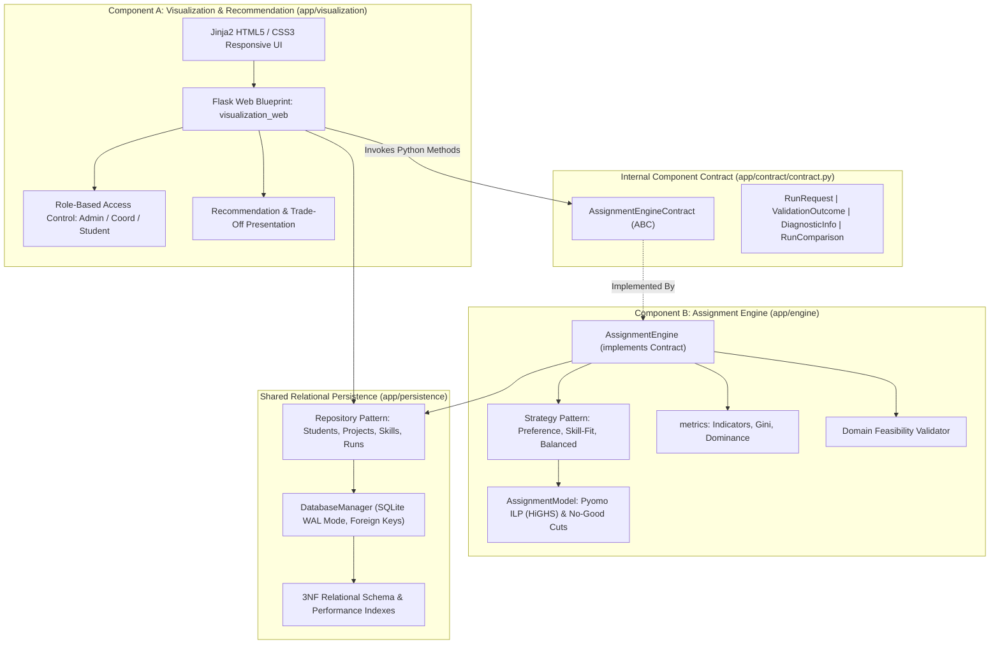
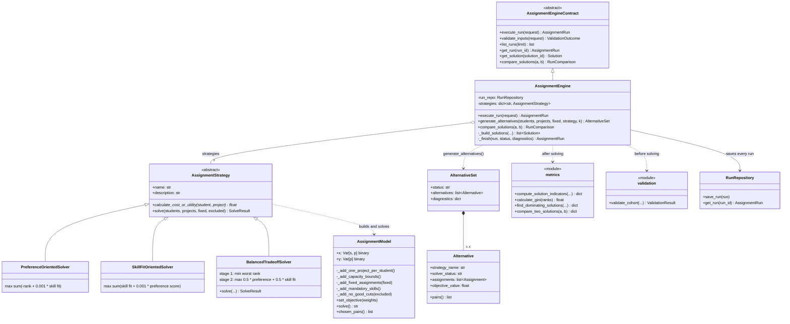
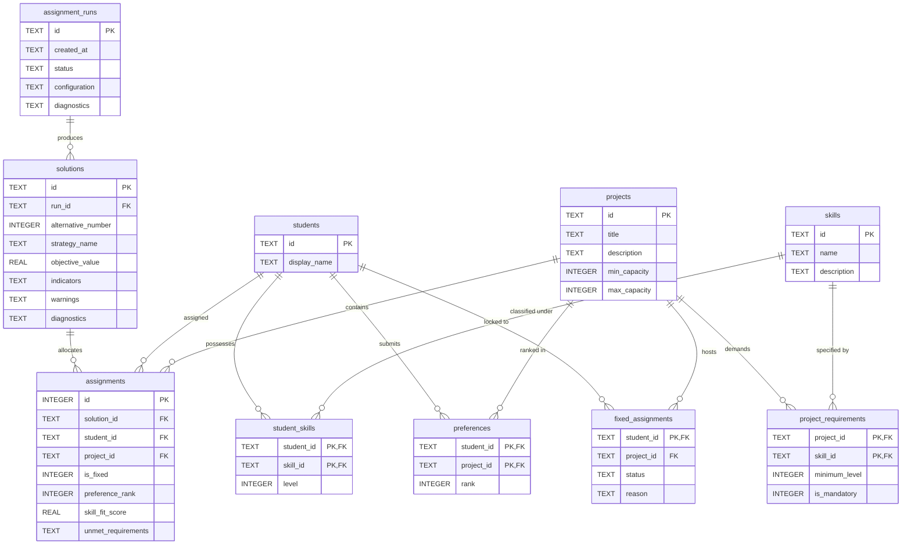

# Deliverable 3: System Architecture Specification & Design Rationale

## 1. Executive Architectural Overview

The **TECH5 Student-to-Project Assignment Decision Support System (DSS)** is an integrated application engineered for the Norwegian School of Economics (NHH). It solves the complex combinatorial allocation problem of assigning a cohort of students to semester research and consulting projects based on multidimensional criteria: **student ranked preferences**, **student skill proficiencies**, **project skill requirements**, **project capacity bounds**, and **administrative pre-allocation locks**.

In accordance with the updated project specification (Sections 5, 7, 8, and 15), the system is architected as **two decoupled, modular application components** running within a single integrated Python application:

1. **Component A (Visualization & Recommendation Component)**:
   - Manages user workflow, cohort data inspection, CRUD interfaces, benchmark scenario seeding, role switching (Admin, Coordinator, Student Viewer), multi-solution visual side-by-side trade-off comparisons, and evidence-backed recommendations.
2. **Component B (Assignment Engine)**:
   - Validates the input, builds a binary integer linear program in **Pyomo** and solves it with **HiGHS**, using the **Strategy Pattern** (`PreferenceOrientedSolver`, `SkillFitOrientedSolver`, `BalancedTradeoffSolver`) to choose the objective. It generates up to K distinct alternatives with no-good cuts, computes feasibility, efficiency, fairness and capacity indicators, flags dominated alternatives, and saves every run with a status and diagnostics.

The two components are mediated strictly by an **internal Python component contract** (`app/contract/contract.py`), backed by a shared relational SQLite 3NF persistence layer (`app/persistence`).

---

## 2. Component Diagram & Internal Interface

---

## 3. Design Rationale: Two-Component Modular Monolith vs. Microservices

### 3.1 Motivation for In-Process Two-Component Architecture
1. **Curricular Alignment & Feasibility**:
   - The primary pedagogical objective is object-oriented software design, relational database integration, and decision support. Microservices introduce substantial operational complexity (distributed networking, ports, HTTP status translation, retries, serialization boilerplate) that distracts from the core analytical problem.
2. **High Modularity Without Operational Overhead**:
   - Component A and Component B maintain strict separation of concerns. Component B has zero knowledge of Flask request objects, HTML templates, or cookies. It can be instantiated, validated, and tested headlessly in pure Python scripts or test harnesses.
3. **Type Safety & Compiler Diagnostics**:
   - In-process contract calls pass typed dataclasses (`RunRequest`, `ValidationOutcome`, `RunComparison`) directly. Type checkers (`mypy`, `pylint`) and IDEs provide immediate syntax and type validation, eliminating runtime JSON schema mismatch errors.
4. **Performance & Determinism**:
   - Direct method invocations eliminate JSON serialization/deserialization CPU cycles and network socket latency, allowing instant interactive comparison and optimization execution.

---

## 4. Object-Oriented Architecture & Design Patterns

### 4.1 Assignment Engine Classes (Component B)

The engine separates **what is allowed** from **what is best**. `AssignmentModel` builds one Pyomo model containing every hard constraint; each `AssignmentStrategy` only sets the objective on that model. `AssignmentEngine` implements the contract and runs the pipeline: validate, solve, compute indicators, save.

### 4.2 Assignment Engine Design Rationale

| Decision | Reason | Alternative rejected |
|---|---|---|
| Constraints in one `AssignmentModel`, objectives in strategies | Every strategy obeys exactly the same hard rules; a new strategy only defines an objective and cannot break feasibility | Each strategy building its own model, which duplicates constraints and lets them drift apart |
| Strategy Pattern with a strategy registry in `AssignmentEngine` | The user picks a strategy by key; adding one means adding a subclass, not editing the engine | `if/else` on the strategy name inside the engine |
| `BalancedTradeoffSolver` overrides `solve()` | It needs two solves (minimise the worst rank, then blend preference and skill fit with the worst rank fixed), which a single objective cannot express | One weighted sum with an arbitrary fairness weight |
| Pyomo with HiGHS (`appsi_highs`) | Same modelling tool as TECH4; HiGHS installs with pip on all platforms and proves infeasibility | PuLP, whose current version no longer bundles a solver |
| Validation before the solver | Data errors give named messages (`INVALID_INPUT`) instead of a solver failure, and simple impossibilities are reported without solving | Letting the solver discover everything |
| Four run statuses: `COMPLETED`, `INFEASIBLE`, `INVALID_INPUT`, `FAILED` | Separates "impossible" from "wrong input" from "broken", so the interface can explain each | One generic error status |
| No-good cuts plus a dominance check | Cuts guarantee distinct alternatives; the check flags an alternative that is not a real trade-off (`dominated_by`) instead of hiding it | Assuming distinct means Pareto-optimal |
| `metrics` as a module of pure functions | Indicators are calculated the same way for every solution and can be tested with hand-calculated examples | Indicator logic inside the strategies |
| Every run saved, including rejected and infeasible ones | Component A loads runs from the database, and the history shows why a run failed | Saving only completed runs |

The mathematical formulation behind these classes is in `docs/analytical_note/analytical_note.pdf`.

### 4.3 Abstract Contract Pattern (Component Boundary)
`AssignmentEngineContract` defines the public interface required by Component A. Concrete `AssignmentEngine` implements all contract methods, ensuring that any mock or alternative solver can be substituted without touching Component A.

### 4.4 Repository Pattern (Data Access Layer)
Persistence operations are encapsulated into domain repositories:
- `StudentRepository`: Manages `students`, `student_skills`, and `preferences`.
- `ProjectRepository`: Manages `projects` and `project_requirements`.
- `SkillRepository`: Manages defined competencies.
- `FixedAssignmentRepository`: Manages administrative pre-allocation locks.
- `RunRepository`: Manages `assignment_runs`, `solutions`, and `assignments`.

---

## 5. Relational Database Architecture

---

## 6. Role-Based Access Control (RBAC)

The application models three explicit business roles in `app/visualization/auth.py`:
1. **Course Administrator (`ADMIN`)**: Full authorization. Can edit students, projects, skills, and fixed assignments, trigger optimization runs, and switch active roles.
2. **Program Coordinator (`COORDINATOR`)**: Operational authorization. Can manage fixed assignment locks, trigger solver runs, and inspect detailed recommendations and comparisons. Read-only on baseline student data.
3. **Student Viewer (`STUDENT`)**: Transparency view. Can browse anonymized dashboard metrics, project descriptions, and high-level allocation summaries. Mutating actions are disabled.
